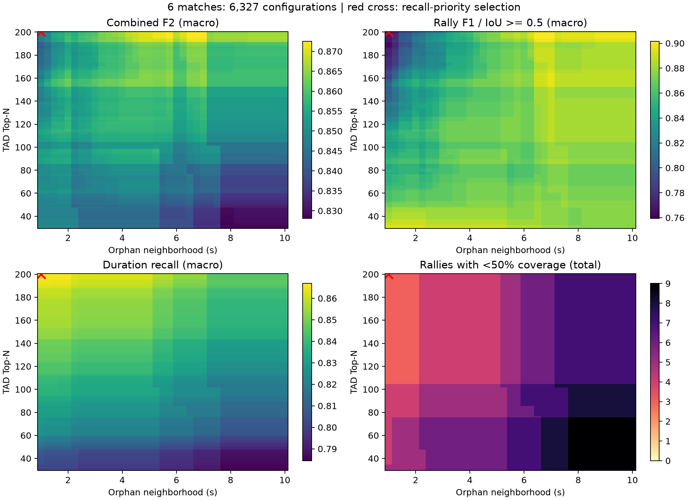

# 六场女单比赛：TAD/OCR 融合参数实验

实验日期：2026-11-13。目标是在尽量不漏回合的前提下，选择一组跨视频通用的 TAD Top-N 与孤立候选临近距离。原视频不剪辑，输出用于 RallyMark 回合导航。

结果：建议体验配置为 **Top-N=200、临近距离=2秒**；六场共121个GT回合无完全漏检，但仍有3个覆盖不足一半。回合F1均值80.15%，时间召回均值86.65%。F1最高配置(198,6.5)的回合F1为90.15%，但完全漏掉3个回合。

## 数据与评估口径

| ID | 对手 | 时长（秒） | GT 回合 | GT 阳性时长（秒） |
| --- | --- | ---: | ---: | ---: |
| nina | 妮娜·米特兰姆 | 260.04 | 15 | 64 |
| sun | 孙颖莎 | 411.02 | 19 | 90 |
| harimoto | 张本美和 | 462.02 | 20 | 100 |
| hayata | 早田希娜 | 548.02 | 24 | 139 |
| wang | 王艾米 | 312.02 | 19 | 89 |
| chen | 陈熠 | 522.02 | 24 | 110 |
| 合计 | 六场 | 2515.14 | 121 | 592 |

五张新增标注图片转写为逐回合 JSON，保留原图核对；原有 Nina 使用已有截图转写标注。标签为整秒精度，不做边界扩展。比分不参与评估，也不会从 GT 注入预测。所有原视频、标注、原始预测、候选融合关系与评估表均在本地成对保存。

- **时间指标**：真实回合区域为阳性，区间并集的交集时长为 TP，其余预测时长为 FP，其余真实时长为 FN。报告 Precision、Recall、F1 与 F2；F2 对 FN 的惩罚为 FP 的四倍。
- **回合指标**：预测与 GT 做最大数量的一对一匹配，主阈值 IoU ≥0.5，另给 IoU ≥0.3 的敏感性结果。一个很长的预测不能匹配多个真实回合。
- **漏检指标**：分别统计完全没有交集、覆盖不足 50%、覆盖至少 90% 的真实回合。IoU 匹配失败可能是边界偏差或过度合并，不能全部称为完全漏检。
- **聚合**：参数选择对六场等权平均（macro）；另提供合并 TP/FP/FN 的 pooled 指标，避免大视频掩盖小视频表现。

## 固定预处理与搜索协议

TAD 使用固定模型快照，保存全部 200 个回合候选，按置信度排序后取 Top-N；搜索每个整数 N=30…200。孤立 TAD 与已合法回合的临近距离搜索 1…10 秒，步长 0.25 秒。共 6,327 组通用参数、37,962 条逐视频评估记录。该距离仅影响孤立候选的接纳，不会填平相邻回合之间的空白。

融合代码直接复用产品后处理：先合并重叠 TAD；与 OCR 重叠时取最早开始、OCR 的结束；独立 OCR 保留；独立 TAD 仅在远离已合法区间时保留。GPU 推理不读取 GT，搜索阶段只重算 CPU 后处理，不反复运行模型。

比分板在不同转播中发生横向平移。原固定裁剪会使孙颖莎场 OCR 候选为零，因此在查看搜索得分前先固定纯画面校准规则：前 60 秒均匀取 12 帧，在固定纵向区域寻找 53 像素宽的紫色局数列，水平偏移搜索 [-85,150] 像素；可见率阈值 0.5，至少三个可见样本且位置一致。左侧不足部分补边。六场分别采用 X=85、33、79、28、2、-16，纵向位置与 OCR 识别、时序规则均不变。旧固定裁剪结果另存用于审计。这仅支持当前相同样式比分板的横向移动，不能视为任意布局检测。

预先定义三种选择方式：主策略最大化 macro 时间 F2 与回合 F2 的均值；F1 策略最大化二者 F1 均值；召回优先策略在综合 F1 不低于最优 F1 的 90% 时，依次减少覆盖不足 50% 的回合、IoU 匹配失败回合，再提高时间召回。最后用接近原默认 (200,5) 的规则打破同分。

每种策略都做六折留一场验证：用五场选参数，仅在剩下一场评分。全六场选择的结果用于给现有素材生成统一配置；其成绩是样本内结果，不能当作新视频性能保证。

## 结果与推荐

**本地体验建议使用 Top-N=200、临近距离=2 秒。** 该点在六场中没有完全漏掉的回合，IoU≥0.5 回合 F1 的逐场均值为 **80.15%**，时间召回均值为 **86.65%**。它是查看网格后选择的实际使用折中点，不是预先定义的 F2 最优点，也没有独立测试集成绩。

预先定义的严格召回策略选 (200,1)，与 (200,2) 的回合 TP/FN、完全漏检数和不足50%覆盖数完全一致；但 (200,2) 将 IoU≥0.5 的 FP 从62降至47，仅减少0.347秒真实覆盖（六场合计），macro时间召回下降0.04个百分点。考虑整秒GT精度，选择整数2秒作为体验默认。若希望保留每一个可疑片段，可加载1秒版本；若希望减少跳转点，可对照F1版本，但其会漏掉三个完整回合。

下表除数量外均为逐场等权平均；“完全漏”表示与GT无正时长交集，“不足半覆盖”也计入完全漏。回合FP按IoU≥0.5一对一匹配计算，边界不合格的真实回合也可能同时形成一FP和一FN。

| 方案 | Top-N | 距离秒 | 时间Recall | 时间F1 | 回合Recall | 回合F1 | 完全漏 | 不足半覆盖 | 回合FP |
| --- | --- | --- | --- | --- | --- | --- | --- | --- | --- |
| 固定裁剪基线 | 200 | 5 | 72.84% | 75.92% | 79.37% | 75.64% | 1 | 20 | 39 |
| 校准后基线 | 200 | 5.0 | 86.25% | 81.35% | 91.76% | 87.06% | 1 | 4 | 24 |
| 预定义F2最优 | 198 | 5.75 | 85.69% | 81.53% | 91.76% | 88.96% | 2 | 5 | 19 |
| 预定义F1最优 | 198 | 6.5 | 85.29% | 81.77% | 91.07% | 90.15% | 3 | 6 | 15 |
| 预定义严格召回 | 200 | 1.0 | 86.69% | 80.36% | 92.46% | 75.94% | 0 | 3 | 62 |
| 建议体验点（事后选择） | 200 | 2 | 86.65% | 80.95% | 92.46% | 80.15% | 0 | 3 | 47 |

OCR位置校准的收益明显大于本轮精调参数：保持(200,5)时，回合F1从75.64%升至87.06%，时间召回从72.84%升至86.25%。推荐参数及以下结果均以校准OCR为前提；产品算法适配器尚未接入该实验校准，单改部署YAML不能直接复现这里的跨布局结果。

F2最优点的综合F2为87.25%，F1最优点的综合F1为85.96%（“综合”指时间与回合对应指标的均值，不是另一个标准F1定义）。F1最优点的回合F1虽达90.15%，却完全丢弃早田希娜00:04–00:08、张本美和00:12–00:15、陈熠00:09–00:12三段：这三段均依赖独立TAD，距离邻近合法区间分别仅2.229、5.026、5.975秒，6.5秒排除范围会将其误删。因此不把F1最高点直接用作召回优先的默认值。



图中颜色范围分别由右侧色条标注，红叉是预定义严格召回策略(200,1)，不是建议体验点(200,2)。较大临近范围通常减少误报，也可能排除真实的独立TAD；Top-N的作用受区间合并和OCR覆盖影响，不能视为单调提升效果。

### 建议体验点的逐场结果

| 比赛ID | GT | 预测 | 回合Precision | 回合Recall | 回合F1 | 时间Recall | 时间F1 | 不足半覆盖 |
| --- | --- | --- | --- | --- | --- | --- | --- | --- |
| nina | 15 | 23 | 65.22% | 100.00% | 78.95% | 93.93% | 83.72% | 0 |
| sun | 19 | 20 | 90.00% | 94.74% | 92.31% | 86.48% | 81.92% | 0 |
| harimoto | 20 | 26 | 65.38% | 85.00% | 73.91% | 85.48% | 78.78% | 1 |
| hayata | 24 | 32 | 68.75% | 91.67% | 78.57% | 74.58% | 80.22% | 2 |
| wang | 19 | 26 | 73.08% | 100.00% | 84.44% | 91.60% | 82.01% | 0 |
| chen | 24 | 31 | 64.52% | 83.33% | 72.73% | 87.80% | 79.04% | 0 |

合并六场计数（pooled）为158个预测、121个GT：回合TP=111、FP=47、FN=10，Precision=70.25%、Recall=91.74%、F1=79.57%；时间TP=505.205秒、FP=155.126秒、FN=86.795秒，时间F1=80.68%、时间Recall=85.34%。macro与pooled的差异来自每场权重不同。

IoU阈值放宽至0.3时，121个GT均有一对一匹配，pooled回合F1为86.74%；这表示粗定位基本覆盖，不表示边界完整。仅69/121个回合覆盖达到90%，118/121达到50%。

### 留一场选参验证

下表严格按五场选参、一场评分汇总；它评估选参流程，不是把全六场最优参数再次称作测试结果。建议体验点(200,2)是事后固定选择，未宣称有独立留出成绩。

| 流程 | 回合F1 | 回合Recall | 时间Recall | 完全漏 | 不足半覆盖 |
| --- | --- | --- | --- | --- | --- |
| F2选参策略 | 86.87% | 90.19% | 84.55% | 4 | 7 |
| F1选参策略 | 87.34% | 89.08% | 84.35% | 4 | 7 |
| 严格召回选参策略 | 77.98% | 91.76% | 86.19% | 1 | 4 |

F2策略逐折参数与该场回合F1：

| 留出比赛 | 五场训练选择Top-N/距离秒 | 留出场回合F1 |
| --- | --- | --- |
| nina | 198 / 5.25 | 90.91% |
| sun | 198 / 8.75 | 89.47% |
| harimoto | 199 / 5.75 | 80.95% |
| hayata | 198 / 5.75 | 82.35% |
| wang | 198 / 5.75 | 100.00% |
| chen | 198 / 6.5 | 77.55% |

逐场使用本场GT单独选参的诊断参考如下；这些值是样本内oracle，只用于判断统一参数的取舍，不能部署成自动“每场最佳”配置。

| 比赛 | 本场F2最优Top-N/距离秒 | 回合F1 |
| --- | --- | --- |
| nina | 200 / 6.5 | 100.00% |
| sun | 200 / 5.0 | 94.74% |
| harimoto | 68 / 5.0 | 87.80% |
| hayata | 159 / 2.0 | 86.27% |
| wang | 183 / 6.5 | 100.00% |
| chen | 161 / 5.0 | 81.63% |

## 未解决的边界问题

整个搜索网格中最高macro时间召回也只有86.69%。**零完全漏检不等于完整保留回合。** 建议体验点仍有三段覆盖不足一半：

- 张本美和03:40–03:50：预测03:45.25–03:49.75，OCR-only，覆盖45%。
- 早田希娜02:05–02:15：预测02:09.25–02:13.75，TAD/OCR融合，覆盖45%。
- 早田希娜08:37–08:43：预测08:39.068–08:41.385，TAD-only，覆盖38.62%。

因此下一轮改进应检查长回合开始时间、OCR结束偏差和缺失OCR下的短TAD片段，不能期待仅扩大Top-N或调距离就消除所有截断。当前OCR仍使用固定4.5秒回溯及既有比分稳定/延迟规则，本实验没有调整这些超参数。

比分显示未在本轮评估。导出沿用原OCR的比分与保守补全逻辑；初次出现比分板可能生成伪回合或错误初始比分。例如孙颖莎场首次比分板直到27秒才确认，旧规则产生20.5–25秒的首次出现候选，随后与下一条OCR融合为20.5–28.75秒，沿用0:0标签。该标签不应当作人工校验的真实比分。没有可靠比分的回合显示“比分待确认”，全无比分时才使用序号。

六场来自同一运动员且转播相似，样本量较小。留一场仅验证超参数选择，不重训模型；未核实原模型训练集是否包含这些比赛，不能据此声称对全新赛事的泛化性能。整秒GT也限制了亚秒级边界结论。

## 运行与本地交付

TAD源快照为FTT demo提交`540cc9fb903698d57658dbd7bd98a758ede577e0`，RallyMark实验工具基于`f081bd8`；后处理及推理数学未改动。TAD检查点SHA-256为`19f8fe270cd3cf3da7127db415298316b38338dfae55aa9bdf23f82d5b7d2f40`，VideoMAEv2骨干为`beeb240f58d51dfb41dbbef71346fe14ce3a8e33e1b1772df26af06634ede5fc`。完整权重/源码/输入哈希和依赖版本保存在本地provenance。运行设备为单张RTX4090D、PyTorch2.0.1+cu117；所有TAD峰值显存为10.28GiB。

Nina复用此前同一模型、同一视频SHA的完整200候选TAD结果，未重新计为本轮GPU推理；其OCR与其他五场使用同一新校准规则重跑。下表“TAD推理”是脚本内计时，墙钟含初始化；OCR墙钟含画面校准、抽帧和识别。CPU OCR与后续GPU任务并行，耗时不可简单相加作为总历时。

| 比赛 | TAD推理秒 | TAD墙钟秒 | 校准OCR墙钟秒 | 固定/校准OCR候选 |
| --- | --- | --- | --- | --- |
| nina | 316.55（缓存） | 未重跑 | 111.63 | 15 / 15 |
| sun | 512.37 | 564.46 | 92.04 | 0 / 18 |
| harimoto | 568.50 | 603.67 | 100.76 | 19 / 19 |
| hayata | 660.03 | 726.41 | 122.68 | 0 / 22 |
| wang | 356.39 | 426.33 | 79.13 | 0 / 19 |
| chen | 630.59 | 707.08 | 98.78 | 0 / 22 |

全六场CPU网格搜索耗时32.21秒。所有原始结果和首次备份验证成功后，GPUHub按正常stop→确认stopped→release→确认未分配的顺序释放；最终gpu-1/gpu-2均stopped且hasReserved=false，未保留算力。

本地数据根目录（相对仓库）为`.runtime/experiments/20261113-001/`：

| 内容 | 位置 |
| --- | --- |
| 原片、GT及标注原图 | `videos/`、`gt/` |
| 原始200候选、固定/校准OCR、来源与耗时 | `raw/`、`layout/`、`provenance/` |
| 全部37,962行指标 | `results/evaluation/grid.csv` |
| 汇总、逐场对比、留一场策略与Pareto结果 | `results/evaluation/summary.json`、`comparison.csv`、`policy_comparison.csv` |
| 建议体验点指标与逐GT覆盖诊断 | `results/evaluation/operating_recommendation.json`、`gt_coverage_recommended.csv` |
| 建议体验点(200,2)六份JSON及YAML片段 | `review/` |
| 严格召回(200,1) / F1最优(198,6.5)对照 | `review-strict/`、`review-f1/` |
| 初始/最终metadata归档，不重复压缩视频 | 仓库`backups/experiments/20261113-001-metadata.tar.gz`及SHA-256旁文件 |

原片在本地保留独立硬链接，metadata归档覆盖GT、原始候选、全网格、配置、报告来源与导出JSON；权重已有独立FTT demo本地副本，不需要GPU机器继续存活。raw与视频不进入Git。

仅启动前端即可复盘：

```sh
pnpm --dir apps/web dev --host 127.0.0.1 --port 5173
```

打开`http://127.0.0.1:5173/?local=1`，选择`videos/`中的原片，再为每场选择`review/<同名ID>.json`。选择对照目录的JSON可以切换参数效果。文件仅在浏览器读取，配对会检查文件大小与时长；不运行API、数据库或GPU，也不重新上传视频。详见[本地复盘说明](../../apps/web/LOCAL_REVIEW.md)。

实际六段原片均在390×844浏览器载入并播放，六份JSON分别得到23/20/26/32/26/31个标记，无配对错误、无横向溢出、无API请求；点击下一回合直接播放。视频与主要播放控件均位于首屏。


验证：`make check`、`make test`通过；核心实验指标14测、前端17测和2项手机端浏览器测试通过。未配置测试数据库的3项既有数据库集成测试跳过，本实验未更改数据库行为。另有OCR裁剪3项合成验证与六场实际画面检查。GitLab旧runner离线状态尚未改变，本报告不将本地检查等同为远程CI通过。

复现网格、导出与图表命令见[实验工具说明](../../scripts/experiments/README.md)。本次推荐只作为现有六场的体验配置，未自动覆盖部署默认配置。
