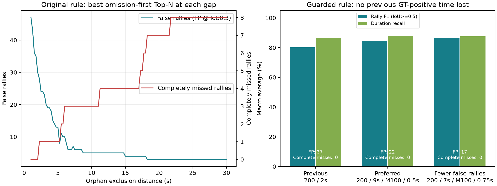

# 六场比赛：漏检优先的扩展搜索

实验日期：2026-11-13。目标为先避免遗漏，再降低假回合。本轮复用[前一轮实验](../20261113-001/report.md)的六场视频、121个GT回合、全部200个TAD候选及校准OCR，不重跑模型，不申请GPU，不更改产品默认算法。

**推荐先体验：Top-N=200、间隔9秒、保护前100个TAD候选、孤立最小时长0.5秒。** 六场完整漏检仍为0/121，旧配置已覆盖的真实时间全部保留；假回合由37降至22，减少40.54%。回合F1均值由80.15%升至84.75%，时间召回由86.65%升至87.91%。这是带候选保护的实验规则，不能只把产品原规则的间隔改成9秒来复现。

## 搜索方式

原规则中，独立TAD只要接近已合法区间就会被丢弃。临近区间可能来自延迟或不准确的OCR，因此扩大间隔既能减少假回合，也可能直接排除真实回合。

第一阶段仅扩大原规则的参数范围：Top-N=1…200，间隔1…30秒、步长0.25秒，共23,400组/场。旧范围的37,962行逐视频指标与上一轮结果全部一致（误差容限1e-12），确认实验重算没有悄悄改变原算法。

第二阶段增加两个**仅用于实验**的参数：

1. **保护前M个原始TAD候选**：在全视频200个候选中按置信度排序。一个独立合并区间只要包含前M名中的任意成员，就不因临近而被排除；M必须不大于Top-N。保护作用于独立TAD，OCR融合方式不变。
2. **孤立片段最小时长**：只删除短于指定长度的独立TAD，先检查时长再检查排名保护。不会用该阈值过滤OCR区间或TAD/OCR混合区间。

粗搜索采用Top-N=1…200，M∈{0,10,20,30,50,100,200}，间隔∈{1,2,3,4,5,6,8,10,12,15,20,30}秒，最小时长∈{0,0.5,1,1.5,2}秒，共59,760组/场。

第三阶段围绕粗搜索结果细化：Top-N=160…200，M=50…100逐整数，间隔∈{5,8,10,12,15,20,25,30,45,60,600}秒，最小时长0…2秒、步长0.25秒，共207,009组/场。600秒超过全部视频长度，用来检查“抑制所有未受保护独立候选”的极限，不把它当作合理的实际推荐间隔。细化和确认阶段分数完全相同时优先更少的保护数量和更短间隔。早期粗搜曾在同分时取较长间隔，因此其平台代表点显示30秒；相应实际执行源码已归档，平台内区间已另行核验。

第四阶段固定Top-N=200，将M扩展到0…200逐整数；间隔1…30秒、步长0.25秒，另含45/60/600秒；最小时长仍为0…2秒、步长0.25秒，共217,080组/场。四个阶段共执行3,043,494行逐视频评估；阶段存在重复配置，不将这些行全部声称为独立不同配置。

在可变最小时长的留一场检查中，未使用早田希娜场选参时会倾向2秒过滤，留出场因此丢失旧配置已覆盖的0.4秒。为落实遗漏优先，最终操作方案将最小时长固定为更保守的0.5秒、使用整数间隔，复用第四阶段网格的6,633组/场重新选参。这部分是39,798行结果重筛，不额外计入新增融合评估数。

## 漏检约束与指标

以旧推荐(Top-N=200、间隔2秒)为参考。每个候选配置必须满足：

- 旧结果已经覆盖到的GT阳性时间，在新结果中全部保留（丢失时间≤1e-8秒，仅容忍浮点误差）。这是逐时间片的包含约束，而非只要求总召回率不降低。
- 每场IoU≥0.3和IoU≥0.5的一对一回合匹配FN均不增加。
- 在上述约束下，先比较完整漏检、覆盖不足50%、回合FN，再减少未匹配预测，最后比较时间TP与F1。

GT仅用于评分和训练集选参，不进入融合函数。约束在现有六场上的成立不等于对新视频的保证。

“假回合”用IoU≥0.3最大数量一对一匹配后的FP计数；IoU≥0.5的FP还包括边界不够准确的真实回合，另行报告。时间F1、时间Recall和回合F1继续使用原评估器。比例默认按六场等权平均（macro）；TP/FP/FN与回合数量使用合并计数（pooled）。

## 结果与选择

原规则扩大搜索后，最优漏检优先点仍在2秒附近；Top-N=192、间隔2秒虽可减少假回合，但会比旧点少覆盖1.011秒GT时间，因此没有将它作为新的“零退步”推荐。

推荐使用保守方案，而不直接使用允许过滤阈值自由调节、且满足不退步和漏检优先条件时选出的点。后者为(200,7秒,M100,0.75秒)，假回合可降至17、回合F1为86.51%，但比保守方案少覆盖1.545秒GT、少一个达到90%覆盖的回合。二者均不丢失旧配置已经覆盖的GT秒；保守方案在新发现的有效片段上保留更多时间，更符合遗漏优先的要求。

| 方案 | 完全漏 | 不足半覆盖 | ≥90%覆盖 | 假回合FP@0.3 | FP@0.5 | 回合F1均值 | 时间Recall均值 |
| --- | --- | --- | --- | --- | --- | --- | --- |
| 旧推荐：原规则200/2 | 0 | 3 | 69 | 37 | 47 | 80.15% | 86.65% |
| 原规则扩展选参192/2 | 0 | 3 | 68 | 30 | 40 | 82.04% | 86.46% |
| 新规则：保守推荐200/9/M100/0.5 | 0 | 1 | 70 | 22 | 32 | 84.75% | 87.91% |
| 新规则：更少假回合200/7/M100/0.75 | 0 | 1 | 69 | 17 | 27 | 86.51% | 87.66% |

推荐方案有143个预测，IoU≥0.5回合TP=111、FP=32、FN=10，pooled回合F1=84.09%；IoU≥0.3时TP=121、FP=22、FN=0。时间TP=513.706秒、FP=151.313秒、FN=78.294秒，pooled时间Recall=86.77%、时间F1=81.73%。macro与pooled的权重不同，不能混用。

“0个完整漏检”不表示边界完整。120/121个回合覆盖达到50%，仅70/121达到90%；仍有一个回合不足半覆盖。GT时间误差、固定OCR回溯和TAD边界问题尚未消除。

### 推荐方案逐场结果

| 比赛 | GT/预测 | 假回合FP@0.3 | FP/FN@0.5 | 回合F1 | 时间Recall | 旧GT覆盖丢失秒 |
| --- | --- | --- | --- | --- | --- | --- |
| nina | 15/19 | 4 | 4/0 | 88.24% | 93.93% | 0.000 |
| sun | 19/20 | 1 | 2/1 | 92.31% | 86.48% | 0.000 |
| harimoto | 20/23 | 3 | 6/3 | 79.07% | 89.38% | 0.000 |
| hayata | 24/31 | 7 | 9/2 | 80.00% | 77.24% | 0.000 |
| wang | 19/23 | 4 | 4/0 | 90.48% | 92.61% | 0.000 |
| chen | 24/27 | 3 | 7/4 | 78.43% | 87.80% | 0.000 |

### 较长间隔与保护规则各自的作用

| 间隔秒 | 保护M | 最小时长秒 | 完整漏检 | 假回合 | 时间TP秒 | 回合F1均值 |
| --- | --- | --- | --- | --- | --- | --- |
| 2 | 0 | 0 | 0 | 37 | 505.205 | 80.15% |
| 7 | 0 | 0 | 3 | 8 | 496.229 | 89.57% |
| 7 | 100 | 0 | 0 | 31 | 513.706 | 81.84% |
| 7 | 0 | 0.75 | 3 | 4 | 496.229 | 90.80% |
| 7 | 100 | 0.75 | 0 | 17 | 512.161 | 86.51% |
| 7 | 100 | 0.5 | 0 | 23 | 513.706 | 84.52% |
| 30 | 100 | 0.5 | 0 | 22 | 513.706 | 84.75% |

单纯将原规则从2秒改到7秒，假回合会减少，但完整漏掉3个回合；同时加入短片段过滤也无法解决误删。候选保护使长间隔不再无条件删除高排名独立TAD，短片段过滤再减少保护机制带来的碎片。收益来自这些条件的组合。

在推荐M100、最小时长0.5秒固定时，9/10/15/30/60/600秒产生完全相同的六场区间；因此选最短的整数平台值9秒。更少假回合方案的0.75秒固定时，7…30秒及60/600秒检查点区间一致。没有理由因为“更长”而盲目设置到30或600秒。

这里的间隔是未受保护孤立TAD的排除邻域，不是合并9秒内的两个回合。仍只合并重叠区间。

左图按每个间隔各自选择漏检优先的Top-N；右图为最终操作点。新旧规则的作用不能混为单独调节间隔。

## 留一场与限制

最终保守选参过程固定200个候选和0.5秒过滤，仅用五场选择M与整数间隔，再在留出场评估。六折完整漏检均为0，且六个留出场均没有丢失旧配置已覆盖的GT秒、没有增加该场IoU≥0.3/0.5的FN。

| 留出比赛 | 五场选择：间隔/M | 留出场回合F1 | 旧GT秒丢失 | 约束通过 |
| --- | --- | --- | --- | --- |
| nina | 9.0/100 | 88.24% | 0.000 | True |
| sun | 9.0/100 | 92.31% | 0.000 | True |
| harimoto | 9.0/100 | 79.07% | 0.000 | True |
| hayata | 8.0/58 | 86.27% | 0.000 | True |
| wang | 9.0/100 | 90.48% | 0.000 | True |
| chen | 9.0/100 | 78.43% | 0.000 | True |

该过程的留一场回合F1均值为85.80%，时间Recall均值为87.46%；合并假回合18个，完全漏检0个，不足半覆盖2个。这里评估的是逐折选参过程，不是把全六场推荐点再次称为独立测试。

保护规则、细化范围及保守过滤限制都受到这六场观察的影响。留一场只能提供当前固定流程的稳定性线索，不能消除研究方案设计阶段的数据适配，也不能保证新素材零遗漏。原模型训练集与这些素材的重合情况仍未知。比分未重新评估，沿用原OCR与保守补全；初次比分板出现造成的错误标签问题仍见前一轮报告。

## 本地交付与复现

数据根目录为`.runtime/experiments/20261113-002/`，未重新申请GPU。原始TAD/OCR、GT和视频SHA与前一轮一致，输入JSON及标注图片另存于`inputs/`，`videos/`以相对链接指向仍保留的原片。

| 内容 | 位置 |
| --- | --- |
| 原规则扩展全网格/按距离汇总 | `unchanged/grid.csv`、`by_distance.csv`、`summary.json` |
| 新规则粗搜索 | `guarded/` |
| N/M/时长细化 | `refined/` |
| 排名/间隔全范围确认 | `confirmation/` |
| 保守方案重筛与逐折结果 | `conservative/summary.json`、`grid.csv` |
| 新推荐九秒的六场前端metadata | `review/` |
| 少假回合七秒方案的六场metadata | `review-fewer-false/` |
| 原始输入、执行代码及哈希 | `inputs/`、`provenance/` |
| 独立导出复核、逐GT新旧覆盖 | `recommended-validation.json`、`gt-coverage-comparison.csv` |
| 固定参数稳定性/消融 | `stability.json`、`ablations.json` |

四个搜索阶段分别耗时18.76、36.48、149.86、177.41秒（包含该阶段网格导出与选参）。重新筛选不运行模型。本轮GPU新增开销为0。

运行命令见[实验工具说明](../../scripts/experiments/README.md)。所有网格及metadata另有本地压缩备份`backups/experiments/20261113-002-metadata.tar.gz`，视频保留在前一轮数据目录，不依赖任何租用实例。

打开本地前端`http://127.0.0.1:5173/?local=1`，选择`videos/<ID>.mp4`与`review/<ID>.json`。要比较更少假回合方案，改选`review-fewer-false/<ID>.json`；前一轮JSON也仍保留。前端无需后端或GPU。

实验代码保存在`scripts/experiments/search_extended.py`及`search_guarded.py`，产品后处理默认代码与部署配置均未修改。本轮若后续接入算法服务，应将这些规则作为明确的算法版本升级，而不是仅增加一个配置值。

本地验证：`make check`与`make test`通过；实验核心不变量21测通过，已有数据库集成测试3项因未配置测试数据库跳过。六段真实视频及新metadata在390×844浏览器全部载入，无配对错误、无横向溢出、无API请求；单击回合直接播放。

